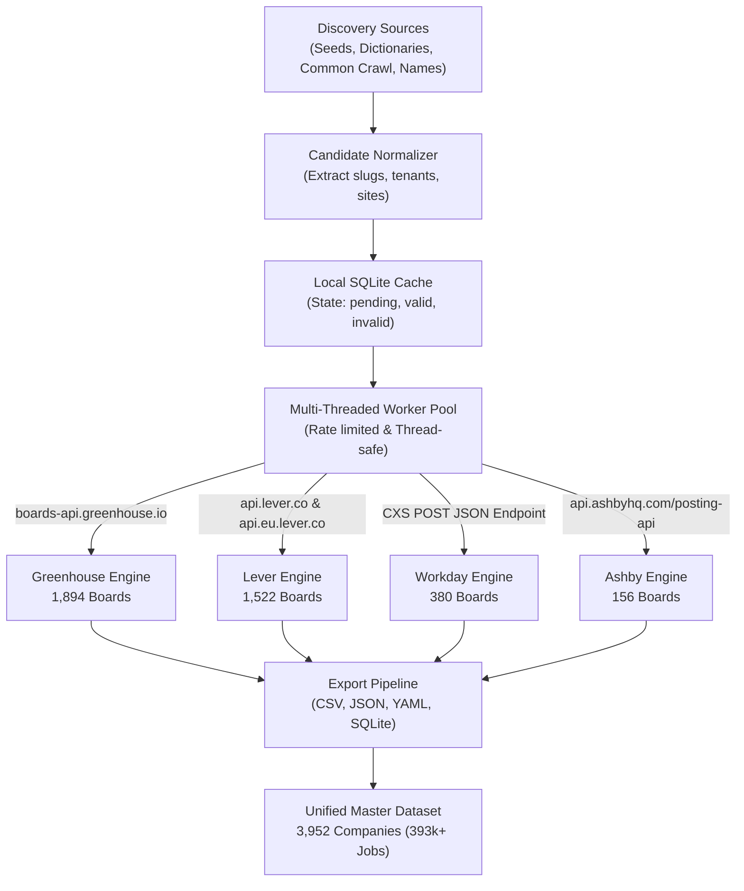

# 🦊 Applyfox

> **The High-Speed ATS Job Board Discovery, Validation, and Market Intelligence Engine.**  
> Automatically discover, validate against official career APIs, count live open jobs, and export structured company datasets across **Greenhouse**, **Lever**, **Workday**, and **Ashby**.

---

[](https://www.python.org/)
[](#-live-fetched-results-summary)
[](#-live-fetched-results-summary)
[](#-supported-applicant-tracking-systems)
[](LICENSE)

---

## 📌 Table of Contents

- [🦊 About Applyfox](#-about-applyfox)
- [📊 Live Fetched Results Summary](#-live-fetched-results-summary)
  - [Overall Multi-Platform Statistics](#overall-multi-platform-statistics)
  - [Top Hiring Companies by Platform](#top-hiring-companies-by-platform)
- [📁 Project Structure](#-project-structure)
- [⚙️ Architecture & Discovery Engine](#️-architecture--discovery-engine)
  - [1. Greenhouse Pipeline](#1-greenhouse-pipeline-gh_discoverpy)
  - [2. Lever Pipeline (Global + EU)](#2-lever-pipeline-lever_discoverpy)
  - [3. Workday Enterprise CXS Pipeline](#3-workday-enterprise-cxs-pipeline-workday_discoverpy)
  - [4. Ashby Pipeline](#4-ashby-pipeline-ashby_discoverpy)
- [🚀 Quickstart & Usage](#-quickstart--usage)
  - [Installation](#installation)
  - [One-Command Orchestration](#one-command-orchestration)
  - [Platform-Specific Execution](#platform-specific-execution)
- [💾 Export Data Schemas](#-export-data-schemas)
- [🏷️ Recommended Repository Names](#️-recommended-repository-names)
- [📜 License](#-license)

---

## 🦊 About Applyfox

Traditional job boards and job aggregators (LinkedIn, Indeed, Google Jobs) suffer from expired listings, ghost jobs, and aggressive rate limits.

**Applyfox** bypasses job board scrapers completely by interfacing directly with the underlying **Applicant Tracking Systems (ATS)** that power company career portals. Using high-throughput multi-threaded HTTP discovery, Common Crawl index queries, and direct REST validation, Applyfox builds verified, canonical databases of companies actively hiring today.

### Core Features:
- **Direct ATS API Validation**: Validates candidate slugs directly against live ATS backend APIs (no headless browser overhead).
- **Live Open Job Counts**: Extracts real-time active vacancy tallies for each verified company board.
- **Multi-Source Discovery**:
  - Curated seed databases (`seeds/`)
  - Petabyte-scale Common Crawl index queries (`CC-MAIN-2024-38`, `CC-MAIN-2026-30`, etc.)
  - Heuristic company name slugifier (`"Warby Parker"` -> `warbyparker`, `warby-parker`, `warbyparkerinc`)
  - Raw GitHub URL repository scraping
- **Multi-Format Persistence**: Exports to **CSV**, **JSON**, **YAML**, and indexed **SQLite** databases.
- **Fail-Safe Throttling**: Thread-safe leaky-bucket rate limiting with connection pooling, exponential backoff, and graceful timeout handling.

---

## 📊 Live Fetched Results Summary

The dataset currently bundled in [`data/`](file:///home/priyanshu/Documents/Applyfox/data) contains **3,952 verified company career boards** and **393,892 active open jobs**.

### Overall Multi-Platform Statistics

| Applicant Tracking System (ATS) | Verified Boards | Boards with Active Jobs (>0) | Total Open Jobs Tracked | Primary Validation Protocol |
| :--- | :---: | :---: | :---: | :--- |
| **Greenhouse** | **1,894** | 1,762 | 86,999 | `GET boards-api.greenhouse.io/v1/boards/{slug}` |
| **Lever** (Global + EU) | **1,522** | 1,246 | 60,264 | `GET api.lever.co/v0/postings/{slug}?mode=json` |
| **Workday** (Enterprise) | **380** | 380 | 238,210 | `POST {tenant}.{wd}.myworkdayjobs.com/wday/cxs/{tenant}/{site}/jobs` |
| **Ashby** (Modern Tech/AI) | **156** | 153 | 8,419 | `GET api.ashbyhq.com/posting-api/job-board/{slug}` |
| **TOTAL UNIFIED** | **3,952** | **3,541** | **393,892** | *Merged in [`data/all_companies_master.csv`](file:///home/priyanshu/Documents/Applyfox/data/all_companies_master.csv)* |

---

### Top Hiring Companies by Platform

#### 🟢 Greenhouse (`data/greenhouse_master.csv`)
| Company | Open Jobs | Verified Career Board |
| :--- | :---: | :--- |
| **SpaceX** | 2,873 | [boards.greenhouse.io/spacex](https://boards.greenhouse.io/spacex) |
| **Pulse Healthcare** | 2,772 | [boards.greenhouse.io/pulse](https://boards.greenhouse.io/pulse) |
| **Anduril Industries** | 2,567 | [boards.greenhouse.io/andurilindustries](https://boards.greenhouse.io/andurilindustries) |
| **Private Equity Insights** | 1,284 | [boards.greenhouse.io/privateequityinsights](https://boards.greenhouse.io/privateequityinsights) |
| **EquipmentShare** | 1,040 | [boards.greenhouse.io/equipmentsharecom](https://boards.greenhouse.io/equipmentsharecom) |
| **BlueSky Telepsych** | 1,005 | [boards.greenhouse.io/blueskytelepsych](https://boards.greenhouse.io/blueskytelepsych) |
| **Databricks** | 910 | [boards.greenhouse.io/databricks](https://boards.greenhouse.io/databricks) |
| **Meridial** | 827 | [boards.greenhouse.io/agency](https://boards.greenhouse.io/agency) |

#### 🔵 Lever (`data/lever_master.csv`)
| Company | Open Jobs | Verified Career Board |
| :--- | :---: | :--- |
| **BoxLunch & Hot Topic** | 4,612 | [jobs.lever.co/boxlunch](https://jobs.lever.co/boxlunch) |
| **Jobgether** | 4,543 | [jobs.lever.co/jobgether](https://jobs.lever.co/jobgether) |
| **TSMG** | 4,454 | [jobs.lever.co/tsmg](https://jobs.lever.co/tsmg) |
| **AO Garcia Agency** | 3,779 | [jobs.lever.co/aogarciaagency](https://jobs.lever.co/aogarciaagency) |
| **TowardJobs** | 1,573 | [jobs.lever.co/usasurveyjob](https://jobs.lever.co/usasurveyjob) |
| **Contact Government Services (CGS)** | 1,429 | [jobs.lever.co/cgsfederal](https://jobs.lever.co/cgsfederal) |
| **LifeStance Health** | 1,399 | [jobs.lever.co/lifestance](https://jobs.lever.co/lifestance) |
| **Insomnia Cookies** | 1,100 | [jobs.lever.co/insomniacookies](https://jobs.lever.co/insomniacookies) |

#### 🟠 Workday (`data/workday_master.csv`)
| Company / Enterprise Board | Open Jobs | Verified Career Board |
| :--- | :---: | :--- |
| **CVS Health** | 19,080 | [cvshealth.wd1.myworkdayjobs.com/...](https://cvshealth.wd1.myworkdayjobs.com/en-US/CVS_Health_Careers) |
| **Lowe's** | 12,575 | [lowes.wd5.myworkdayjobs.com/...](https://lowes.wd5.myworkdayjobs.com/en-US/LWS_External_CS) |
| **RTX (Raytheon Technologies)** | 4,676 | [globalhr.wd5.myworkdayjobs.com/...](https://globalhr.wd5.myworkdayjobs.com/en-US/rec_rtx_ext_gateway) |
| **Northrop Grumman** | 3,747 | [ngc.wd1.myworkdayjobs.com/...](https://ngc.wd1.myworkdayjobs.com/en-US/Northrop_Grumman_External_Site) |
| **Amentum / PAE** | 2,923 | [pae.wd1.myworkdayjobs.com/...](https://pae.wd1.myworkdayjobs.com/en-US/amentum_careers) |
| **Micron Technology** | 2,910 | [micron.wd1.myworkdayjobs.com/...](https://micron.wd1.myworkdayjobs.com/en-US/External) |
| **Target** | 2,514 | [target.wd5.myworkdayjobs.com/...](https://target.wd5.myworkdayjobs.com/en-US/targetcareers) |
| **Walmart** | 2,423 | [walmart.wd5.myworkdayjobs.com/...](https://walmart.wd5.myworkdayjobs.com/en-US/WalmartExternal) |

#### 🟣 Ashby (`data/ashby_master.csv`)
| Company | Open Jobs | Verified Career Board |
| :--- | :---: | :--- |
| **OpenAI** | 809 | [jobs.ashbyhq.com/openai](https://jobs.ashbyhq.com/openai) |
| **Harvey** | 379 | [jobs.ashbyhq.com/harvey](https://jobs.ashbyhq.com/harvey) |
| **Snowflake** | 367 | [jobs.ashbyhq.com/snowflake](https://jobs.ashbyhq.com/snowflake) |
| **Applied Intuition** | 321 | [jobs.ashbyhq.com/applied](https://jobs.ashbyhq.com/applied) |
| **Saronic Technologies** | 255 | [jobs.ashbyhq.com/saronic](https://jobs.ashbyhq.com/saronic) |
| **Sierra** | 219 | [jobs.ashbyhq.com/sierra](https://jobs.ashbyhq.com/sierra) |
| **Base Power Company** | 191 | [jobs.ashbyhq.com/base-power](https://jobs.ashbyhq.com/base-power) |
| **Linear** | 24 | [jobs.ashbyhq.com/linear](https://jobs.ashbyhq.com/linear) |

---

## 📁 Project Structure

```text
applyfox/
├── README.md                   # Complete documentation, benchmarks, and API guides
├── requirements.txt            # Python dependencies (requests, pyyaml)
├── LICENSE                     # MIT License
├── .gitignore                  # Git hygiene rules
│
├── run_all.py                  # Master CLI runner & orchestrator
├── gh_discover.py              # Greenhouse ATS discovery & validation engine
├── lever_discover.py           # Lever ATS discovery & validation engine (Global + EU)
├── workday_discover.py         # Workday CXS enterprise validation engine
├── ashby_discover.py           # Ashby Posting API discovery engine
│
├── data/                       # Validated master datasets & SQLite databases
│   ├── all_companies_master.csv    # 3,952 companies across all 4 platforms
│   ├── greenhouse_master.csv       # 1,894 Greenhouse companies
│   ├── greenhouse_master.json
│   ├── greenhouse_master.yaml
│   ├── gh_master.db                # SQLite DB with indexed slugs & statuses
│   ├── lever_master.csv            # 1,522 Lever companies
│   ├── lever_master.json
│   ├── lever_master.yaml
│   ├── lever_master.db
│   ├── workday_master.csv          # 380 Workday career portals
│   ├── workday_master.json
│   ├── workday_master.yaml
│   ├── workday_master.db
│   ├── ashby_master.csv            # 156 Ashby companies
│   ├── ashby_master.json
│   ├── ashby_master.yaml
│   └── ashby_master.db
│
└── seeds/                      # Input seed lists & pre-crawled directories
    ├── greenhouse_seed.yaml
    ├── lever_seed.yaml
    ├── lever_directory.json        # Curated 23k+ candidate Lever directory
    ├── workday_seed.yaml
    ├── workday_directory.json      # Curated 2.6k+ candidate Workday directory
    ├── ashby_seed.yaml
    ├── ashby_directory.json        # Curated 800+ candidate Ashby directory
    └── names.txt                   # Standard seed company names
```

---

## ⚙️ Architecture & Discovery Engine

Applyfox uses lightweight, targeted network probes to discover candidate slugs and confirm their validity via authoritative JSON APIs:



### 1. Greenhouse Pipeline (`gh_discover.py`)
- **Metadata Endpoint**: `GET https://boards-api.greenhouse.io/v1/boards/{slug}`
- **Jobs Endpoint**: `GET https://boards-api.greenhouse.io/v1/boards/{slug}/jobs`
- **Logic**: Returns HTTP 200 with company name and configuration. An optional secondary request retrieves the full active job array.

### 2. Lever Pipeline (`lever_discover.py`)
- **Global Endpoint**: `GET https://api.lever.co/v0/postings/{slug}?mode=json`
- **EU Endpoint**: `GET https://api.eu.lever.co/v0/postings/{slug}?mode=json`
- **Logic**: Checks the US endpoint first. If HTTP 404, automatically attempts the European endpoint (`api.eu.lever.co`). Both return the job postings list directly in a single request, optimizing throughput.

### 3. Workday Enterprise CXS Pipeline (`workday_discover.py`)
- **Endpoint**: `POST https://{tenant}.{wd_instance}.myworkdayjobs.com/wday/cxs/{tenant}/{site}/jobs`
- **Payload**: `{"appliedFacets": {}, "limit": 20, "offset": 0, "searchText": ""}`
- **Logic**: Workday career portals are Single Page Applications (SPAs) that do not render job details in static HTML. Applyfox directly invokes Workday's internal Client Experience Service (`wday/cxs`) API, which responds with `total` live job counts and company metadata in milliseconds.

### 4. Ashby Pipeline (`ashby_discover.py`)
- **Endpoint**: `GET https://api.ashbyhq.com/posting-api/job-board/{slug}`
- **Logic**: Ashby powers modern tech and AI startups. The public posting API returns an object containing `jobs: [...]`, title, department, employment type, and location data. Company names are resolved from page titles or structured metadata.

---

## 🚀 Quickstart & Usage

### Installation

Requires Python 3.8+:

```bash
git clone https://github.com/your-username/applyfox.git
cd applyfox
pip install -r requirements.txt
```

### One-Command Orchestration

To run the complete pipeline across all 4 ATS platforms with parallel workers, rate limiting, and automated master dataset compilation:

```bash
# Run all platforms with live open job counts (8 parallel workers)
python run_all.py

# Run only specific platforms
python run_all.py --ats greenhouse ashby

# Fast board validation without job counts
python run_all.py --no-jobs --workers 12
```

### Platform-Specific Execution

Each discovery engine can be executed independently with granular flags:

```bash
# --- Greenhouse ---
python gh_discover.py --seed seeds/greenhouse_seed.yaml --jobs
python gh_discover.py --names seeds/names.txt --jobs
python gh_discover.py --cc --max-cc-pages 100

# --- Lever ---
python lever_discover.py --directory seeds/lever_directory.json --jobs --workers 10
python lever_discover.py --seed seeds/lever_seed.yaml --jobs

# --- Workday ---
python workday_discover.py --directory seeds/workday_directory.json --jobs --workers 8
python workday_discover.py --seed seeds/workday_seed.yaml --jobs

# --- Ashby ---
python ashby_discover.py --directory seeds/ashby_directory.json --jobs
python ashby_discover.py --seed seeds/ashby_seed.yaml --jobs
```

---

## 💾 Export Data Schemas

### Unified Master (`data/all_companies_master.csv`)
Contains all validated companies across every platform:

| Field | Type | Description | Example |
| :--- | :--- | :--- | :--- |
| `name` | string | Normalized company name | `OpenAI` |
| `ats` | string | ATS platform identifier (`greenhouse`, `lever`, `workday`, `ashby`) | `ashby` |
| `slug_or_id` | string | Unique identifier, slug, or composite key | `openai` |
| `open_jobs` | integer | Live open job count | `809` |
| `board_url` | string | Direct link to public career portal | `https://jobs.ashbyhq.com/openai` |

---

## 🏷️ Recommended Repository Names

For publishing this repository on GitHub:

| Option | Repository Name | Tagline & Positioning |
| :---: | :--- | :--- |
| **1 (Chosen)** | **`applyfox`** | **Modern, brandable, memorable animal name (like Firefox, GitLab, Celery). Ideal for a standalone product or community tool.** |
| **2** | **`ats-radar`** | High-utility, search-optimized for developers looking for ATS board discovery. |
| **3** | **`applyfox-engine`** | Clarifies the backend/engine nature of the pipeline for data ingestion. |
| **4** | **`hire-scout`** | Friendly, developer-first recruitment intelligence brand. |
| **5** | **`open-career-pipeline`** | Emphasizes open-source job data aggregation and ATS transparency. |

---

## 📜 License

This project is licensed under the MIT License - see the [LICENSE](LICENSE) file for details.

